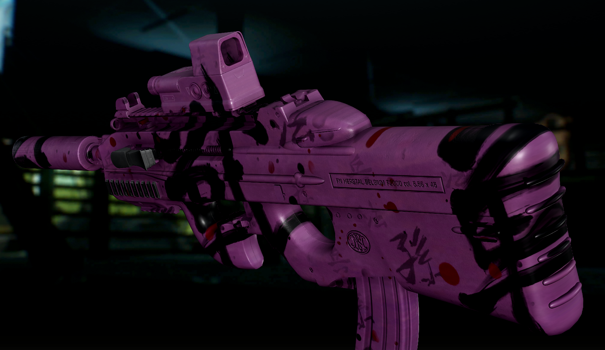

# No Magazine Camo

**Control how weapon camo treats your magazines, and get full, gap-free coverage on the
rest of the gun.** An addon for
[Weapon Camo And Stickers](https://github.com/7Bpencil/SPT.WeaponCamoAndStickers).

## Overview

Weapon Camo And Stickers projects camo onto a weapon from a box around it. The magazine
sits inside that box, so it gets painted along with the gun. During a reload it leaves the
box and snaps back to its stock finish in your hand.

No Magazine Camo lets you decide what magazines do instead. It also fills in the patchy
coverage on surfaces that run alongside the projection.

## Features

### Magazine camo, your choice

- **None:** magazines keep their factory finish, and the rest of the gun is painted
  as usual.
- **Stick to magazine:** magazines wear the gun's camo and keep it through reloads and
  magazine checks, following the magazine as it moves.
- Set a default for every weapon in F12, or pick per weapon from the **Magazine** panel
  beneath the camo editor.
- Revolver and grenade launcher cylinders are never affected.

### Full coverage at Max Angle 0

Projected camo only paints surfaces that face the projection. Edges that run parallel to
it, such as the top of a sight hump, come out patchy or bare, even at Max Angle 0.

With this addon, a layer set to **Max Angle 0** covers every surface inside its box,
including the far side of the gun. Values above 0 work exactly as before, so stickers are
unaffected.



Surfaces that run along the projection can still look slightly stretched. That comes from
how projected camo works, not from missing coverage.

## Settings

Press **F12** and open **No Magazine Camo**. Changes take effect immediately.

| Setting | Default | What it does |
| --- | --- | --- |
| Enabled | On | Turns magazine handling on or off. |
| Camo on magazines | None | **None** keeps magazines clean. **Stick to magazine** carries the camo onto them. A weapon with its own choice in the editor panel ignores this. |
| Max Angle 0 covers everything | On | Turn off to get Weapon Camo And Stickers' original Max Angle 0 behaviour. |

## Requirements

- SPT 4.1.5
- [Weapon Camo And Stickers](https://github.com/7Bpencil/SPT.WeaponCamoAndStickers) 1.18.0
  or newer

## Installation

Extract the zip into your SPT folder. You should end up with:

```
BepInEx/plugins/NoMagazineCamo/NoMagazineCamo.Client.dll
```

To uninstall, delete the `BepInEx/plugins/NoMagazineCamo` folder. The addon never edits
your presets, your profile or Weapon Camo And Stickers itself, so everything goes back to
how it was.

## Compatibility

- Client-only, with no server component.
- Works with Fika. Each player's settings only change what they see on their own screen.
- Only your own weapons are changed. Bots' and other players' guns look exactly as Weapon
  Camo And Stickers draws them.

## Credits

[7Bpencil](https://github.com/7Bpencil), for Weapon Camo And Stickers.
