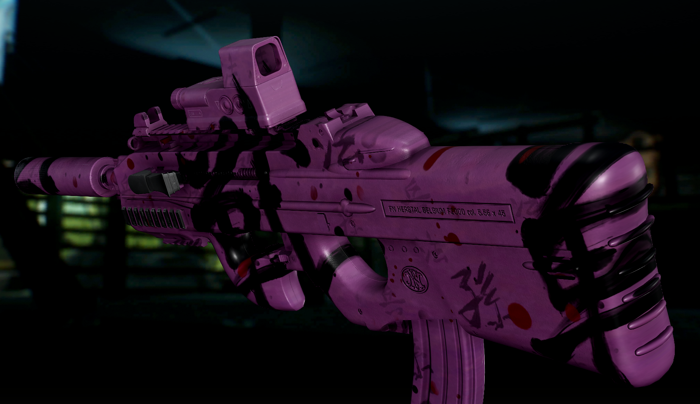

## New

- **Full camo coverage.** Set a camo layer's **Max Angle** to 0 and it now paints everything
  inside its box: the top of the sight hump, the edges along the top, and the other side of
  the gun. No more patchy bare spots. Values above 0 work as before, so stickers aren't
  affected.
- Turn it off in F12 with **Max Angle 0 covers everything** (on by default).

## Install

Extract into your SPT folder, replacing the old version. Requires Weapon Camo And Stickers 1.18.0 or newer.
